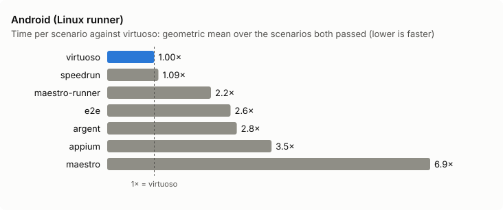
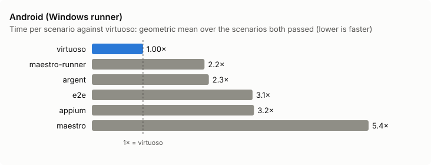
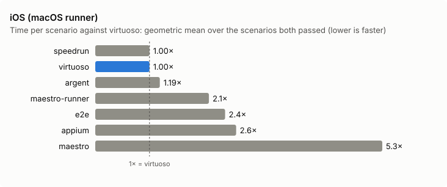

# virtuoso

A fast, Maestro-compatible end-to-end test runner for Android and iOS, written in Rust: one binary
with its device agent built in, waiting for the app instead of the clock, reading the screen
without screenshots. [speedrun](https://github.com/hubastard/speedrun) set the challenge: it
is the bar to beat, and one of the tools the benchmark below compares against.

```yaml
appId: com.example.app
---
- launchApp
- tapOn: "Sign in"
- inputText: "user@example.com"
- tapOn: "Continue"
- assertVisible: "Welcome"
```

```sh
virtuoso test flows/                                   # a folder, as `maestro test` takes it
virtuoso test login.yaml -e PASSWORD=secret --format junit --output report.xml
virtuoso --device emulator-5554,emulator-5556 test flows/ --shard-split 2
virtuoso lint flows/                                   # check flows without a device
virtuoso hierarchy                                     # what is on screen now
virtuoso test flows/ --app-file app.apk --video --format allure
virtuoso test flows/ --continuous                      # run again on every change
virtuoso --auto-start-emulator test flows/             # boot an AVD when nothing is connected
virtuoso session start --app com.example.app           # drive an app a command at a time:
virtuoso do launchApp 'tapOn: Sign in' && virtuoso look  #   run commands, read the screen
virtuoso session save flows/sign-in.yaml               #   the commands that passed, as a flow
virtuoso doctor | virtuoso latency | virtuoso skills       # toolchain check, agent round trips, AI skill
```

## What it supports

The Maestro flow format: every command a Maestro Android flow uses (taps, text, swipes,
scrolling, assertions, app control, links, keys, clipboard, screenshots and visual assertions,
recordings, location and travel, orientation, permissions, media, airplane and dark mode,
`runFlow` (with maestro-runner's `else`), `repeat`, `retry`, scripts) plus maestro-runner's
`wait`, `runShell`, `dragAndDrop`, `openNotifications`, `acceptAlert` and `dismissAlert`; every
selector (text and id regexes with the full syntax, index, states, relative positions,
hierarchy, size, traits), `${...}` JavaScript expressions on QuickJS with `http` (multipart
forms too), `faker` and `require()`, `config.yaml` with globs, tags and execution order, hooks,
JUnit / HTML / JSON / Allure reports, videos, variable values masked in reports, sharding across
devices, and a restart of the device agent if it dies mid-run. `bench/features.json` lists every feature, against maestro-runner and
speedrun, with the reason behind each partial or missing one.

Android devices and emulators, and iOS simulators (`--platform ios`, on a Mac with Xcode; not
real iPhones yet). Runs on Windows (natively), Linux and macOS. On iOS, what a simulator does not
have is not supported, as in Maestro: airplane mode, the Back key, the volume keys; the camera and
notification permissions are the app's to ask for (simctl cannot set them).

## How it works

- `agent/android` — a small Java agent (no Gradle: `javac` + `d8`, built by `build.rs` and
  embedded in the binary). It runs as the shell user through `app_process`, reads every
  window's accessibility tree through a hidden `UiAutomation`, injects input straight into the
  input manager, runs device commands without an adb round trip, and tells when the UI has
  settled (accessibility events going quiet, a main-thread idle probe, and a stable-tree
  check for screens that never stop animating). It speaks length-prefixed JSON over one TCP
  connection through `adb forward`, after a per-run token.
- `agent/ios` — the iOS agent: an XCUITest bundle (Swift) that the binary carries as source and
  builds for the simulator on first use. It serves the same protocol as the Android agent on
  the simulator's (shared) network, sends the screen in the same node format, and answers taps,
  drags, keys and text through XCUITest; the host does the rest with `xcrun simctl` (links,
  location, permissions, media, dark mode, video, clipboard, keychain).
- `crates/virtuoso` — the host: flow parser (`flow`), selector matching (`select`), the runner
  (`runner`, against a `Device` trait), the Android device (`android`, `android_device`), the
  iOS simulator (`ios`),
  JavaScript (`js`), suites (`workspace`), reports (`report`) and the CLI (`main`).
- `crates/virtuoso-bench` — the benchmark harness and the HTML medal report.

## Building

You need Rust, a JDK (17+) and the Android SDK (`ANDROID_HOME`, with a platform and
build-tools). Then:

```sh
cargo build --release          # target/release/virtuoso, agent included
```

Without a JDK or SDK the binary builds with no agent and refuses Android devices.
`VIRTUOSO_AGENT_JAR=<path>` embeds an agent built elsewhere (cross builds).

For iOS, nothing more at build time: on a Mac with Xcode, the first `--platform ios` run
builds the iOS agent for the simulator (about a minute) into `~/Library/Caches/virtuoso` and
keeps it until the agent changes. `VIRTUOSO_IOS_AGENT=<path>` uses one built elsewhere (its
`.xctestrun`). The agent's Xcode project is generated from `agent/ios/project.yml` with
XcodeGen and committed; CI checks the two match.

## Tests

Every feature was built test first (red, then green). Most tests need no device: the runner
runs against a scripted `FakeDevice` (`crates/virtuoso/src/testing.rs`), the parser and
selectors against literals. Tests that need a real device or emulator pass trivially unless
`VIRTUOSO_DEVICE` names one:

```sh
cargo test --workspace                                            # no device needed
VIRTUOSO_DEVICE=emulator-5554 cargo test -p virtuoso -- --test-threads=1   # also on a device
```

The iOS tests need a booted simulator with the fixture app (`agent/ios/Fixture`) installed:
`VIRTUOSO_IOS_DEVICE=<udid> cargo test -p virtuoso --test device_ios --test ios_flows --
--test-threads=1`. GitHub Actions runs them on a macOS runner for every push
(`.github/workflows/ios.yml`): it boots a simulator, builds the fixture app, and lets virtuoso
build its agent as it would on any Mac.

`VIRTUOSO_DEBUG=1` traces every agent call with its time.

## Benchmark

`virtuoso-bench` runs the same flows with each tool — virtuoso, maestro-runner, speedrun,
Maestro, Appium, Tester Army's e2e and Software Mansion's Argent — resets the device before
every run, and writes a results file; `virtuoso-bench report` turns it into a self-contained
HTML page with the medal tables. Three sets of flows: `bench/flows` against Android's Settings
app, speedrun's own benchmark app, and Tester Army's mobile benchmark app (`bench/tam-flows`).
See [docs/benchmark.md](docs/benchmark.md) for the metrics and how to run it.

```sh
cargo build --release -p virtuoso -p virtuoso-bench
target/release/virtuoso-bench run --iterations 5 --out bench/results/results.json
target/release/virtuoso-bench report bench/results/results.json --out report/index.html
```

The results below (between the `benchmark` markers) come from GitHub Actions runs, one field per
platform and host, every tool measured together on the same device: `virtuoso-bench readme
--field <name>=<results.json>... --charts docs/bench` writes them and their charts. A metric is
a medal event of its own in each field, so a tool that wins on one platform and loses on another
shows it: on iOS, speedrun is ahead of virtuoso on the most events.

### Latest results

<!-- benchmark:start -->
Each of the 186 performance events and 55 features is a medal event. A performance metric is an event of its own on each platform and host (Android (Linux runner), Android (Windows runner), iOS (macOS runner)), so a tool that wins on one and not another shows it. Written by `virtuoso-bench readme`, from GitHub Actions runs.

**Overall**

| Tool | 🥇 | 🥈 | 🥉 | Total |
|---|---:|---:|---:|---:|
| [virtuoso](https://github.com/marksmayo/virtuoso) | 173 | 33 | 5 | 211 |
| [speedrun](https://github.com/hubastard/speedrun) | 60 | 56 | 8 | 124 |
| [maestro-runner](https://github.com/devicelab-dev/maestro-runner) | 38 | 24 | 49 | 111 |
| [maestro](https://github.com/mobile-dev-inc/maestro) | 26 | 8 | 7 | 41 |
| [argent](https://github.com/software-mansion/argent) | 13 | 31 | 34 | 78 |
| [e2e](https://github.com/tester-army/e2e) | 5 | 10 | 41 | 56 |
| [appium](https://github.com/appium/appium) | 3 | 5 | 17 | 25 |

**Performance**

| Tool | 🥇 | 🥈 | 🥉 | Total |
|---|---:|---:|---:|---:|
| [virtuoso](https://github.com/marksmayo/virtuoso) | 129 | 33 | 5 | 167 |
| [speedrun](https://github.com/hubastard/speedrun) | 38 | 55 | 6 | 99 |
| [argent](https://github.com/software-mansion/argent) | 13 | 31 | 34 | 78 |
| [e2e](https://github.com/tester-army/e2e) | 5 | 10 | 41 | 56 |
| [maestro-runner](https://github.com/devicelab-dev/maestro-runner) | 3 | 23 | 46 | 72 |
| [appium](https://github.com/appium/appium) | 3 | 5 | 17 | 25 |
| [maestro](https://github.com/mobile-dev-inc/maestro) | 3 | 5 | 3 | 11 |

### Android (Linux runner)



emulator-5554: sdk_gphone64_x86_64 Android 16 (API 36), x86_64 emulator, software GPU (SwiftShader); GitHub ubuntu-latest runner (4 vCPU, 16 GB), Android emulator on KVM.

| Tool | 🥇 | 🥈 | 🥉 | Total |
|---|---:|---:|---:|---:|
| [virtuoso](https://github.com/marksmayo/virtuoso) | 53 | 6 | 1 | 60 |
| [speedrun](https://github.com/hubastard/speedrun) | 14 | 41 | 2 | 57 |
| [e2e](https://github.com/tester-army/e2e) | 3 | 2 | 22 | 27 |
| [argent](https://github.com/software-mansion/argent) | 3 | 2 | 13 | 18 |
| [maestro](https://github.com/mobile-dev-inc/maestro) | 2 | 1 | 0 | 3 |
| [appium](https://github.com/appium/appium) | 1 | 0 | 4 | 5 |
| [maestro-runner](https://github.com/devicelab-dev/maestro-runner) | 0 | 1 | 17 | 18 |

### Android (Windows runner)



emulator-5554: sdk_gphone64_x86_64 Android 16 (API 36), x86_64 emulator, software GPU (SwiftShader); GitHub windows-latest runner (4 vCPU, 16 GB), Android emulator on WHPX.

| Tool | 🥇 | 🥈 | 🥉 | Total |
|---|---:|---:|---:|---:|
| [virtuoso](https://github.com/marksmayo/virtuoso) | 56 | 1 | 1 | 58 |
| [argent](https://github.com/software-mansion/argent) | 4 | 25 | 13 | 42 |
| [maestro-runner](https://github.com/devicelab-dev/maestro-runner) | 1 | 21 | 18 | 40 |
| [e2e](https://github.com/tester-army/e2e) | 1 | 6 | 8 | 15 |
| [maestro](https://github.com/mobile-dev-inc/maestro) | 1 | 3 | 2 | 6 |
| [appium](https://github.com/appium/appium) | 0 | 3 | 7 | 10 |

### iOS (macOS runner)



bench (iOS 26.2 simulator); GitHub macos-15 runner (Apple Silicon, 3 vCPU, 7 GB).

| Tool | 🥇 | 🥈 | 🥉 | Total |
|---|---:|---:|---:|---:|
| [speedrun](https://github.com/hubastard/speedrun) | 24 | 14 | 4 | 42 |
| [virtuoso](https://github.com/marksmayo/virtuoso) | 20 | 26 | 3 | 49 |
| [argent](https://github.com/software-mansion/argent) | 6 | 4 | 8 | 18 |
| [appium](https://github.com/appium/appium) | 2 | 2 | 6 | 10 |
| [maestro-runner](https://github.com/devicelab-dev/maestro-runner) | 2 | 1 | 11 | 14 |
| [e2e](https://github.com/tester-army/e2e) | 1 | 2 | 11 | 14 |
| [maestro](https://github.com/mobile-dev-inc/maestro) | 0 | 1 | 1 | 2 |
<!-- benchmark:end -->

## License

MIT, see [LICENSE](LICENSE). The faker word lists in `crates/virtuoso/src/datafaker` come from
Datafaker and keep its Apache 2.0 license.
